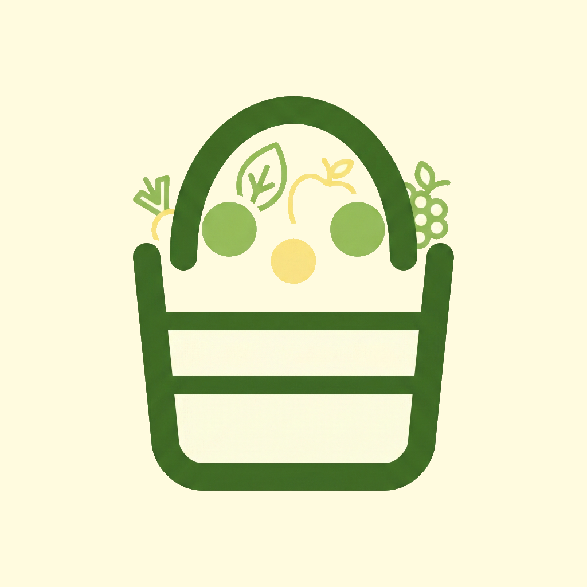
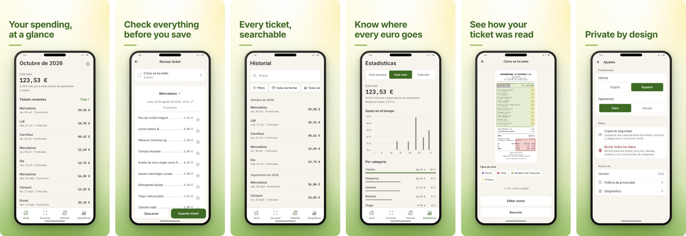

<p align="center">
  
</p>

<h1 align="center">CestApp</h1>

<p align="center">
  <strong>Supermarket receipt scanner that respects your privacy.</strong>
</p>

<p align="center">
  Scan receipts from Mercadona, Carrefour, Lidl, and more. Track spending. Keep your data local.
  Started in Spain, opening to more countries one chain at a time.
</p>

<p align="center">
  <a href="https://github.com/jaimebg/CestApp/releases/latest"></a>
  
  
  
  
  
  
  
</p>

---

<p align="center">
  
</p>

---

## Status

[1.0.0](https://github.com/jaimebg/CestApp/releases/tag/v1.0.0) is in review at the App Store and Google Play.

## Why CestApp?

- **100% on-device**: ML Kit OCR runs locally. No cloud uploads.
- **Any format**: Document scanner, gallery, or PDF.
- **Smart categories**: Auto-sorts items. Learns from your corrections.
- **Supermarket templates**: Pre-trained templates for Spanish chains, with a contribution path for every other country.
- **Multi-language**: English & Spanish UI.

## Features

**Capture**: Document scanner (auto-crop & enhance), gallery import, PDFs. CestApp reads a capture on the spot and opens it in review.

**Review**: Edit the store, date, total and every line before saving. "How it was read" shows the zones over the receipt and the recognized text. If the reading is off, redraw the zones or crop the image to the receipt, and CestApp reads it again. It warns you before you save a duplicate.

**Smart Parsing**: Chain-specific templates detect Mercadona, Carrefour, Lidl, Eroski, Dia, Consum, Alcampo, Aldi, HiperDino by NIF/name patterns.

**Smart reading** (iOS): On iPhones with Apple Intelligence, an on-device model repairs receipts the OCR read badly. CestApp keeps only the items it can match to the OCR text, and checks that their prices add up to the total.

**Organize**: 11 built-in categories, auto-categorization, user learning, store detection.

**Analyze**: Monthly trends, category breakdowns, store comparisons, top items.

**Privacy**: Offline-first, local SQLite, no tracking, no ads. Export everything to a JSON backup. Full policy: [jbgsoft.com/cestapp/privacy](https://jbgsoft.com/cestapp/privacy).

**Details**: Phone and tablet layouts, dark mode, each receipt kept in its own currency and amounts written the way your language writes them, animations that respect Reduce Motion.

## Installation

```bash
git clone https://github.com/jaimebg/CestApp.git
cd CestApp
npm install

# Dev build required (ML Kit needs native code)
npx expo run:ios     # or
npx expo run:android
```

> Expo Go won't work. You need a development build.

## Tech Stack

| Category   | Technology                        |
| ---------- | --------------------------------- |
| Framework  | React Native 0.86.2 + Expo SDK 57 |
| Navigation | Expo Router                       |
| Styling    | NativeWind v4                     |
| Database   | Drizzle ORM + expo-sqlite         |
| State      | Zustand v5                        |
| OCR        | ML Kit (@infinitered)             |
| Fiscal QR  | ZXing (Android), Vision (iOS)     |
| LLM        | Apple Foundation Models (iOS)     |
| PDF        | Custom parser + pako              |
| i18n       | i18next                           |
| Animations | Reanimated v4                     |
| Charts     | react-native-gifted-charts        |

## Project Structure

```
app/           # Screens (Expo Router)
src/
  components/  # UI components
  config/      # Countries and their chain templates, currencies
  db/          # Schema, migrations & queries
  services/    # OCR, fiscal QR, PDF, capture, storage, LLM
  store/       # Zustand state
  theme/       # Palette & type
  i18n/        # Translations
scripts/
  store-screenshots/  # Frames raw captures into the store graphics
  fixtures/           # Scrubs a recorded capture into a chain fixture
modules/
  qr-decoder/         # Native QR decoding for fiscal codes
```

## Development

```bash
npx tsc --noEmit   # Type check
npm test           # Jest, including fixture-based parser tests
npm run check      # ESLint + Prettier
```

CI runs all three on every push. If you change the parser, extend the fixtures in `src/services/ocr/__tests__/`. Chain fixtures under `src/config/countries/*/__tests__/fixtures/` test themselves; `npm run fixture` makes one from a recorded capture (see [CONTRIBUTING.md](CONTRIBUTING.md)).

Releases build locally and ship through fastlane. The `fastlane/` folder holds credentials and store assets, so it stays out of the repo.

## How It Works

1. **Detect Chain and Country**: Identifies the supermarket and its country by tax ID, store name patterns, or fingerprints (brand names like "Hacendado" for Mercadona). Where the receipt carries a fiscal QR code readable offline (Portugal, Austria), its total, date and tax ID take precedence
2. **Apply Template**: Uses chain-specific parsing rules (layout, item patterns, OCR corrections)
3. **Extract**: ML Kit OCR for images, custom parser for PDFs. The parser uses the capture's zones when it has them, then the geometry of its text blocks, then its lines alone
4. **Categorize**: User corrections → keyword matching → default

Learning is store-aware: same item can have different categories at different stores.

## Supported Countries and Chains

| Country  | Chains                                                                                                 |
| -------- | ------------------------------------------------------------------------------------------------------ |
| Spain    | Mercadona, Carrefour, Lidl, Eroski, Dia, Consum, Alcampo, Aldi, HiperDino (with IGIC tax for Canarias) |
| Portugal | None yet: fiscal QR codes are read, chains are waiting for contributions                               |
| Austria  | None yet: fiscal QR codes are read, chains are waiting for contributions                               |

Your country or chain is missing? [Donate a ticket](../../issues/new?template=donate-ticket.yml): a photo is enough.

## Contributing

The most useful contributions are receipts and chain templates from countries CestApp can't read
yet: [donate a ticket](../../issues/new?template=donate-ticket.yml) (no code needed), or write the
template for a donated one. [CONTRIBUTING.md](CONTRIBUTING.md) covers both, plus adding a country
or a UI language.

## License

MIT. See [LICENSE](LICENSE).

---

<p align="center">
  Made with care by <a href="https://github.com/jaimebg">JBGSoft - Jaime Barreto</a> 🧡
</p>
